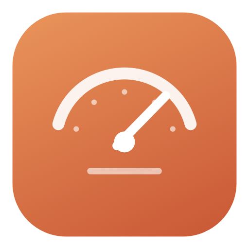

<div align="center">
  
  <h1>Gauge</h1>
  <p>AI 구독 사용량을 한눈에 보는 macOS 메뉴 막대 앱</p>
  <p>
    <a href="https://github.com/ZeroOneDeveloper/Gauge/releases/latest/download/Gauge-macOS-universal.dmg"><strong>Mac용 다운로드 (DMG)</strong></a>
    · <a href="https://github.com/ZeroOneDeveloper/Gauge/releases">전체 릴리스</a>
    · <a href="README.md">English</a>
  </p>
</div>

Claude와 Codex 계정 여러 개의 구독 한도와 초기화 시간을 확인하는 SwiftUI 앱입니다. 최신 소스 버전은 Google Antigravity CLI의 Gemini 사용량도 지원합니다.

## 다운로드 및 설치

**[Gauge 다운로드 — Apple Silicon / Intel Mac](https://github.com/ZeroOneDeveloper/Gauge/releases/latest/download/Gauge-macOS-universal.dmg)**

macOS 14 이상에서 실행됩니다. Universal 앱 하나로 Apple Silicon과 Intel Mac을 모두 지원합니다.

1. DMG를 다운로드해 엽니다.
2. **Gauge.app을 Applications 폴더로 드래그**합니다.
3. 응용 프로그램 폴더에서 Gauge를 실행하고 **계정 추가**로 로그인합니다.

ZIP 파일은 [Releases](https://github.com/ZeroOneDeveloper/Gauge/releases)에서 받을 수 있으며 `SHA256SUMS.txt`로 다운로드 파일의 무결성을 확인할 수 있습니다.

배포 파일은 Developer ID로 서명했습니다. **v1.1.1은 Apple 공증을 아직 완료하지 않았습니다.** 첫 실행이 차단되면 **시스템 설정 → 개인정보 보호 및 보안 → 확인 없이 열기(Open Anyway)**를 선택하세요. [Apple의 첫 실행 안내](https://support.apple.com/102445)를 참고할 수 있습니다.

기존 사용자는 Gauge를 종료한 뒤 응용 프로그램 폴더의 앱을 교체하세요. 연결한 계정과 사용량 기록은 그대로 사용합니다. 로그인할 때 앱을 시작하려면 Gauge의 **설정 → Mac 로그인 시 자동 실행**을 켜세요.

Claude 브라우저 로그인에는 설치된 공식 **Claude Code CLI**, Codex 로그인에는 **Codex 앱 또는 CLI**가 필요합니다. CLI는 설치 파일에 포함하지 않습니다. Claude 계정은 **계정 추가 → Claude → 브라우저에서 로그인**으로 Gauge 전용 로그인을 연결하는 것을 권장합니다.

GitHub의 v1.1.1 설치 파일은 Claude와 Codex를 지원합니다. Gemini와 리셋 사용권 표시를 사용하려면 최신 소스로 빌드하세요.

## 소스에서 실행

```sh
git clone https://github.com/ZeroOneDeveloper/Gauge.git
cd Gauge
./scripts/build.sh
open dist/Gauge.app
```

빌드에는 Swift 6을 포함한 Xcode 또는 Command Line Tools가 필요합니다. 설치된 유효한 Developer ID Application 인증서가 있으면 같은 앱 식별자로 서명합니다. `GAUGE_SIGN_IDENTITY`로 인증서를 지정할 수 있습니다. 인증서가 없는 개발 환경에서는 임시 서명(ad-hoc)으로 빌드하므로 바이너리를 바꾸면 키체인 승인이 다시 필요할 수 있습니다. 배포용 Universal 빌드와 공증 방법은 [릴리스 안내](docs/RELEASING.md)에 있습니다.

처음 실행하면 계정이 없는 대시보드가 나타납니다. 화면에는 실제 조회한 사용량만 표시하며, 계정·인증 정보·사용량 기록은 다운로드 파일이나 저장소에 포함하지 않습니다.

## 맥 상단 메뉴 막대에서 보기

오른쪽 상단의 **계기판 모양 Gauge 아이콘**을 누르면 작은 사용량 창이 열립니다. 계정을 연결하면 핀으로 선택한 서비스 전체 계정의 잔여 한도가 아이콘 옆에 표시됩니다. 예를 들어 Claude 3개 계정의 주간 잔여량이 80%, 60%, 40%라면 `Claude 주간 180/300% 남음`으로 표시합니다. 팝오버 위쪽의 서비스 버튼에서 메뉴 막대에 고정할 서비스를 선택하세요. 5시간·주간·모델별 한도는 각각 합산합니다. 작은 창에서는 연결한 모든 계정을 확인할 수 있습니다.

아이콘을 찾기 어려우면 대시보드 오른쪽 위의 **메뉴 막대에서 보기**를 누르세요. 대시보드 창을 닫아도 메뉴 막대 앱과 자동 갱신은 계속 실행됩니다. 완전히 종료하려면 작은 창 오른쪽 아래의 **전원 버튼**을 누르세요. **설정** 버튼은 설정 화면을 바로 엽니다.

## 계정 연결

### 이 Mac의 기존 로그인 연결

**이 Mac 계정 연결**은 기존 Claude Code 키체인과 `~/.codex`의 로그인 프로필을 사용합니다. 원래 CLI가 인증 정보를 계속 관리하며, Gauge는 refresh token을 복사하거나 별도 회전시키지 않습니다. 이후 새로고침에서도 원래 로그인 정보를 읽습니다. CLI에서 다른 계정으로 전환하면 기존 계정의 사용량으로 덮어쓰지 않고 재연결을 안내합니다.

Claude 계정을 계속 유지하려면 **계정 추가 → Claude → 브라우저에서 로그인**으로 전용 로그인을 연결하는 것을 권장합니다. 공유 로그인은 Claude Code의 계정 전환이나 키체인 저장 변경에 영향을 받습니다. 기존 공유 계정에 문제가 생기면 계정 관리의 **로그인 연결 복구**로 같은 이메일의 전용 로그인으로 전환하세요. 계정 식별자·이름·고정·기록을 유지하며 원래 CLI 로그인은 변경하지 않습니다.

기존 Claude Code 토큰이 만료되기 직전이거나 만료되어 있으면 Gauge가 공식 CLI를 통해 자동 갱신을 시도하고 원래 저장소에서 새 토큰을 읽습니다. 이 갱신은 안전 모드에서 `/usage` 시작 과정만 이용하며 사용자 입력, 폴더 신뢰 승인, 추론 요청을 보내지 않습니다. MCP·도구·훅은 비활성화하고 완료·실패·종료 시 전용 프로세스 그룹을 정리합니다. 동시에 여러 조회가 요청되어도 하나의 갱신만 실행합니다. Codex 인증 갱신은 공식 앱 서버가 처리합니다. 이 방식으로 연결한 계정을 Gauge에서 해제해도 원래 CLI에서 로그아웃하지 않습니다.

### Claude

1. **계정 추가 → Claude**에서 계정 이름을 입력합니다.
2. **브라우저에서 로그인**을 누르면 설치된 공식 Claude Code의 로그인 페이지가 기본 브라우저에서 열립니다. Google·Apple·이메일 로그인을 사용할 수 있습니다.
3. 로그인을 완료하고 Gauge로 돌아오면 실제 사용량을 조회한 후 계정이 자동 등록됩니다. 브라우저에 인증 코드가 표시되면 앱의 **브라우저에 인증 코드가 표시되었나요?**를 펼쳐 입력하세요.

내장 웹 로그인 창은 사용하지 않습니다. 계정마다 `~/Library/Application Support/Gauge/ClaudeProfiles/{UUID}`의 별도 `CLAUDE_CONFIG_DIR`와 전용 키체인 항목을 사용합니다. 만료 직전에는 해당 전용 프로필의 refresh token과 원래 scope로 Claude의 OAuth 토큰 엔드포인트에 일반 세션 갱신을 요청합니다. 새 refresh token이 반환되면 같은 저장소에 보관하며, 갱신 전에 쓰기 권한부터 확인합니다. 기존 Claude Code 로그인 프로필과 분리됩니다. 연결을 취소하면 진행 중인 로그인 프로세스와 미완료 전용 프로필을 정리합니다.

Claude Code를 이용할 수 없으면 **sessionKey / OAuth 토큰으로 직접 연결**을 펼치세요. 일반 브라우저에서 `claude.ai`에 로그인하고 개발자 도구의 **Application → Cookies → https://claude.ai → sessionKey** 값을 앱의 보안 입력란에 붙여 넣으세요. `sessionKey=…` 형식과 전체 `Cookie:` 헤더도 지원합니다. 입력한 값 중 `sessionKey`만 저장합니다.

`sk-ant-oat…` 형식의 Claude OAuth 액세스 토큰 또는 `claudeAiOauth.accessToken`이 있는 Claude Code 인증 JSON 파일도 가져올 수 있습니다. 사용량 조회에는 `user:profile` 권한이 필요합니다. 일반 API 키나 추론 전용 `setup-token`으로 구독 한도를 조회할 수 없습니다. 가져온 OAuth 토큰은 복사본이므로 만료 시 직접 다시 가져와야 합니다. 원래 CLI의 refresh token을 회전시키거나 인증 파일을 수정하지 않습니다.

Claude 조회는 `claude.ai/api/organizations/{id}/usage` 또는 `api.anthropic.com/api/oauth/usage`의 **비공개 인터페이스**를 사용합니다. 공급자 변경, 세션 만료, Cloudflare 확인에 따라 연결이 실패할 수 있으며 해당 상태를 화면에 표시합니다. 브라우저로 로그인한 계정은 전용 프로필에서 자동 갱신합니다. 갱신이 거절되면 계정 관리의 **다시 로그인**으로 같은 계정을 복구할 수 있습니다. 계정 식별자, 이름, 고정 및 기존 기록을 유지하며 다른 이메일로 로그인하면 반영하지 않습니다. 이 Mac의 기존 Claude 로그인도 이 방법으로 Gauge 전용 로그인으로 전환할 수 있습니다.

v1.1.1부터 재로그인은 새 임시 프로필에서 진행합니다. 이메일과 실제 사용량을 확인한 뒤 기존 계정의 인증 저장소에 반영하므로, 이전 인증의 만료나 저장 문제로 재로그인이 반복되는 상황을 줄입니다. 인증 서버의 일시적인 거절·보안 확인과 갱신 토큰 만료를 구분하며, 키체인 저장 실패도 별도로 안내합니다.

### Codex

1. **계정 추가 → Codex**에서 이름을 입력합니다.
2. **브라우저에서 로그인**으로 ChatGPT 구독 계정에 로그인합니다.
3. 로그인이 끝나면 사용량을 조회하고 계정이 등록됩니다.

설치된 Codex 앱 또는 CLI의 공식 `codex app-server`를 사용합니다. 실행 파일을 자동으로 찾지 못하면 **설정 → Codex 실행 파일**에서 지정하세요. 지원하는 Codex 버전이 필요하며 `account/login/start`, `account/read`, `account/rateLimits/read`를 사용합니다. API 키 과금 사용량은 대상이 아닙니다.

계정마다 `~/Library/Application Support/Gauge/CodexProfiles/{UUID}`의 전용 `CODEX_HOME`을 사용합니다. `cli_auth_credentials_store="keyring"`으로 Codex가 인증 정보를 macOS 키체인에 저장하고 갱신합니다. 일반 Codex 프로필과 분리됩니다. 새 계정 추가 시 브라우저에 같은 계정이 로그인돼 있으면, 로그인 링크를 복사해 다른 브라우저 프로필에서 여세요. 동시에 다른 Codex 로그인이 진행 중이면 로컬 콜백 포트 충돌이 날 수 있습니다.

### Gemini

1. [Google Antigravity CLI](https://antigravity.google/docs/install?tab=cli) 1.1.11 이상을 설치한 뒤 터미널에서 `agy`를 실행해 Google 계정에 로그인합니다.
2. Gauge에서 **계정 추가 → Gemini**를 선택하고 이름을 입력한 뒤 **이 Mac 로그인 연결**을 누릅니다.

현재 Antigravity CLI 로그인 한 개의 모델 그룹별 한도와 초기화 시각을 표시합니다. CLI가 로그인을 관리하고 Gauge는 Google 인증 정보를 가져오거나 저장하지 않습니다. Gemini 웹과 Gemini API 사용량은 별도입니다. [Antigravity 사용량 안내](https://antigravity.google/docs/cli/commands/usage)

## 기능

- 여러 Claude·Codex 계정과 현재 Gemini CLI 세션을 조회, Claude → Codex → Gemini 순서 정렬과 제공자별 필터
- Claude와 Codex가 반환한 리셋 사용권의 잔여 개수와 확인 가능한 만료 시각 표시. Claude의 Fable 리셋권은 별도 표시
- 제공자가 반환한 사용 한도와 초기화 시각 표시 (누락된 한도를 0%로 표시하지 않음)
- Claude의 Fable 등 모델별 한도, 기능별 한도 및 추가 사용 크레딧을 제공자가 반환하는 경우 표시
- 서비스별 고정과 전체 계정 잔여 한도 합산, 팝오버에서 기간별 합계 및 개별 계정 확인
- 1·2·5·10분 자동 갱신, 계정별 오류 및 재시도 지연, 잠자기 중 갱신 중단
- 마지막 성공값과 갱신 시각 유지, 오래되거나 초기화 시각이 지난 값은 별도 표시
- 80%·95% 한도 알림, 설정에서 **Mac 로그인 시 자동 실행** 켜기
- 약 5분 간격의 사용률 기록과 24시간·7일·30일 그래프
- 계정 이름 변경, 인증 및 기록 삭제

그래프는 앱 실행 중 관찰한 **한도 사용률**이며 토큰 수나 결제 금액이 아닙니다. 메뉴 막대 합계는 같은 서비스·같은 기간의 계정별 잔여 비율을 더한 값입니다. 계정당 100%를 기준으로 하며 서로 다른 기간은 합치지 않습니다. 조회 실패, 누락, 10분 경과 또는 초기화 대기 계정이 있으면 전체 합계를 `—`로 표시하고 확인된 계정 수를 안내합니다. 기본 갱신 간격은 2분입니다. 사용량 정보가 10분 넘게 오래되거나 초기화 시각이 지났으면 메뉴 막대는 `—`를 표시하고 새 측정을 기다립니다.

## 데이터

직접 입력한 Claude 인증 정보는 `kr.uniquegood.gauge.credentials` 서비스의 계정별 키체인 항목에 저장합니다. 브라우저로 로그인한 Claude 인증은 공식 CLI의 전용 프로필별 키체인에 보관합니다. 직접 로그인한 Codex 인증은 Codex 자체 키체인 저장소에서 관리합니다. **이 Mac 계정 연결**로 등록한 계정은 Claude Code 키체인과 원래 Codex 프로필의 인증 저장소를 그대로 사용하며 refresh token을 복사하지 않습니다. 계정 메타데이터와 최대 30일간의 사용량 기록은 `~/Library/Application Support/Gauge/state.json`에 저장합니다. 디렉터리는 700, 상태 파일은 600 권한을 사용합니다. 로그인 URL, 토큰, 서버 응답을 로그에 출력하지 않습니다. 앱 자체 분석 및 원격 서버는 없습니다. Codex와 Claude 실행 시 분석을 비활성화하는 설정을 전달합니다.

Gauge의 자동 조회는 키체인 암호창을 표시하지 않습니다. Claude에 새로 로그인하거나 계정 관리에서 **키체인 접근 허용**을 누르면 macOS가 해당 항목에 대한 승인을 요청할 수 있습니다. **항상 허용**은 해당 키체인 항목에 대한 승인을 기억합니다. 임시 서명에서 Developer ID 서명으로 처음 전환할 때도 기존 항목에 한 번 더 승인이 필요할 수 있습니다. 키체인 접근이 거절되면 기존 항목을 덮어쓰지 않습니다. 상태 파일을 읽을 수 없으면 기존 데이터 보호를 위해 저장을 중단하고 오류를 표시합니다. 전용 계정 연결 해제는 Gauge가 관리하는 인증 정보와 기록을 삭제합니다.

## 개발 및 검증

```sh
swift build
swift test
python3 scripts/smoke_codex.py
./scripts/build.sh
open dist/Gauge.app
```

자동 테스트는 제공자 응답 파싱, 모델·기능별 사용 한도, 기간별 잔여량 합산, 누락 및 만료 처리, 인증 갱신, 계정 분리 및 기록 보존을 검증합니다. Codex 스모크 테스트는 임시 프로필에서 프로토콜 초기화와 로그아웃 상태 조회만 확인합니다. 실제 계정의 로그인·사용량 조회는 앱의 **이 Mac 계정 연결** 또는 **계정 추가**로 확인할 수 있습니다.

공식 Codex 문서: [앱 서버](https://learn.chatgpt.com/docs/app-server#auth-endpoints), [인증 저장소](https://learn.chatgpt.com/docs/auth#credential-storage). Claude 인터페이스 참고: [CodexBar Claude provider 문서](https://github.com/steipete/CodexBar/blob/main/docs/claude.md).

Claude Code 공식 문서: [인증과 여러 계정 로그인](https://code.claude.com/docs/en/authentication#log-in-with-multiple-accounts).

## 기여 및 라이선스

버그 제보와 기능 제안은 [Issues](https://github.com/ZeroOneDeveloper/Gauge/issues), 코드 기여는 [기여 안내](CONTRIBUTING.md)를 확인하세요. 보안 문제는 [SECURITY.md](SECURITY.md)를 참고해 비공개로 제보해 주세요.

Gauge 코드는 [MIT License](LICENSE)로 공개합니다. 제공자 아이콘의 출처와 라이선스는 [THIRD_PARTY_NOTICES.md](THIRD_PARTY_NOTICES.md)에 있습니다. Claude·Codex 이름과 상표는 각 권리자의 소유이며, Gauge는 Anthropic·OpenAI와 제휴하지 않은 독립 프로젝트입니다.
