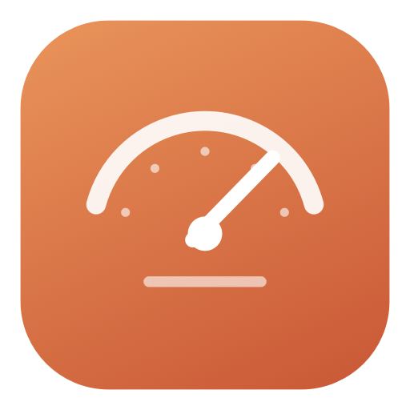

<div align="center">
  
  <h1>Gauge</h1>
  <p>A macOS menu bar app for AI subscription usage.</p>
  <p>
    <a href="https://github.com/ZeroOneDeveloper/Gauge/releases/latest/download/Gauge-macOS-universal.dmg"><strong>Download for Mac (DMG)</strong></a>
    · <a href="https://github.com/ZeroOneDeveloper/Gauge/releases">Releases</a>
    · <a href="README.ko.md">한국어</a>
  </p>
</div>

Gauge tracks subscription limits and reset times for multiple Claude and Codex accounts. The current source also supports Gemini through Google Antigravity CLI. Gauge is free, open source, and runs locally.

## Install

1. [Download the universal DMG](https://github.com/ZeroOneDeveloper/Gauge/releases/latest/download/Gauge-macOS-universal.dmg) for macOS 14 or later on Apple Silicon or Intel.
2. Open the DMG and drag **Gauge.app** to **Applications**.
3. Launch Gauge and choose **계정 추가** (Add Account).

The [release page](https://github.com/ZeroOneDeveloper/Gauge/releases) also provides a ZIP and `SHA256SUMS.txt`. The v1.1.1 download is signed with a Developer ID and shipped without Apple notarization. If macOS blocks the first launch, go to **System Settings → Privacy & Security → Open Anyway**. [Apple's instructions](https://support.apple.com/102445)

To update, quit Gauge and replace it in **Applications**. Connected accounts and usage history carry over. To start Gauge when you log in to your Mac, enable **설정 → Mac 로그인 시 자동 실행** in the app.

The GitHub v1.1.1 installer supports Claude and Codex. Build from source for Gemini and one-time reset credit counts.

## Build from source

```sh
git clone https://github.com/ZeroOneDeveloper/Gauge.git
cd Gauge
./scripts/build.sh
open dist/Gauge.app
```

The build requires Swift 6 from Xcode or the Command Line Tools. The script uses a valid Developer ID Application identity when it finds one. Set `GAUGE_SIGN_IDENTITY` to select a specific identity. Otherwise, the script uses an ad-hoc signature, which may require renewed Keychain approval after a rebuild. See the [release guide](docs/RELEASING.md) for a universal distribution build and notarization.

## Use the menu bar

Click the gauge icon to open the usage popover. Pin a provider to show the total remaining quota across its accounts next to the icon. If three Claude accounts have 80%, 60%, and 40% of their weekly limits left, Gauge shows **180/300%** remaining. The popover shows each account and keeps five-hour, weekly, and model-specific limits separate.

If the icon is hidden, choose **메뉴 막대에서 보기** (Show in Menu Bar) on the dashboard. Closing the dashboard keeps Gauge running. Use the power button in the popover to quit.

## Connect accounts

### Claude

1. Install [Claude Code](https://code.claude.com/docs/en/quickstart).
2. Choose **계정 추가 → Claude**, name the account, and click **브라우저에서 로그인** (Sign in with Browser).
3. Complete sign-in and return to Gauge. If the browser shows an authorization code, enter it in the sheet. If macOS asks for Keychain access, select **Always Allow** to remember that approval for the item.

Each browser sign-in uses a separate Claude Code profile and Keychain item. Gauge refreshes that profile when its token approaches expiration. If refresh fails, choose **다시 로그인** (Sign In Again) and use the same email. Gauge verifies the replacement login before saving it and preserves the account's name, pin, and history. macOS may request approval for the new Keychain item created during sign-in. Background refresh uses noninteractive Keychain access.

**이 Mac 계정 연결** (Connect Accounts on This Mac) can also use your existing Claude Code session. Claude Code owns its refresh token. Gauge reads the existing session and lets the CLI refresh it if needed. Use **로그인 연결 복구** (Repair Login Connection) to move a shared Claude connection to a dedicated profile while keeping its history.

The manual option accepts a Claude web `sessionKey` or a Claude OAuth access token with `user:profile`. You can also import a Claude Code credentials JSON file. A manually imported access token needs to be replaced when it expires. Gauge reads Claude's subscription limits using Claude's private usage interfaces, so upstream changes or web session checks can affect the connection. [Claude Code authentication](https://code.claude.com/docs/en/authentication#log-in-with-multiple-accounts)

### Codex

Install the Codex app or CLI and choose **계정 추가 → Codex → 브라우저에서 로그인**. Sign in with a ChatGPT subscription account. If Gauge cannot locate the executable, select it under **설정 → Codex 실행 파일**.

Gauge uses `codex app-server` to sign in and read rate limits. Dedicated accounts have their own `CODEX_HOME` and use the Codex Keychain store. **이 Mac 계정 연결** can use your existing `~/.codex` login. To sign in to several accounts, use the appropriate browser profile for each login and finish one login before starting the next. [Codex app server](https://developers.openai.com/codex/app-server/) · [Codex authentication](https://developers.openai.com/codex/auth/)

### Gemini

1. Install [Google Antigravity CLI](https://antigravity.google/docs/install?tab=cli) version 1.1.11 or later and run `agy` in Terminal to sign in to Google.
2. In Gauge, choose **계정 추가 → Gemini**, name the connection, and click **이 Mac 로그인 연결** (Connect This Mac's Login).

Gauge reads the current Antigravity CLI session's model-group limits and reset times via its built-in `/usage` command. One Gemini connection follows the active CLI login. The CLI handles authentication and Gauge does not read or store Google credentials. The connection covers Antigravity coding quotas. Gemini web and Gemini API usage have separate limits. [Antigravity model quotas](https://antigravity.google/docs/cli/commands/usage)

## Usage and data

- Dashboard, provider filters, menu bar totals, and per-account history.
- Provider-reported limits and resets, including Claude Fable and other model-specific limits when available.
- Remaining one-time reset credits for Claude and Codex when reported, including Fable reset grants and the nearest known expiration.
- Automatic refresh every 1, 2, 5, or 10 minutes, with per-account retry delays and refresh paused during sleep.
- Optional notifications at 80% and 95% used, plus launch at Mac login.
- Usage history for up to 30 days, with charts for 24 hours, 7 days, and 30 days.

Each account contributes up to 100 percentage points to a pinned provider's total. If a reading is missing, failed, more than 10 minutes old, or past its reset time, Gauge shows `—` for the total and displays how many accounts were confirmed. History records quota percentages observed while Gauge is running.

Gauge stores account metadata and usage history in `~/Library/Application Support/Gauge/state.json`. Claude and Codex sign-in credentials are protected by the macOS Keychain. A provider's existing CLI sign-in remains available if you unlink it from Gauge. Gauge has no backend or analytics.

## Develop

```sh
swift build
swift test
python3 scripts/smoke_codex.py
```

The Codex smoke test checks the app-server handshake and signed-out state with a temporary profile. To verify live usage, sign in through **계정 추가** or connect an existing login.

Report bugs and request features in [Issues](https://github.com/ZeroOneDeveloper/Gauge/issues). See [CONTRIBUTING.md](CONTRIBUTING.md) for contributions and [SECURITY.md](SECURITY.md) for private security reports.

Gauge is available under the [MIT License](LICENSE). See [THIRD_PARTY_NOTICES.md](THIRD_PARTY_NOTICES.md) for icon attribution. Gauge is an independent project. Provider names and marks belong to their respective owners.
